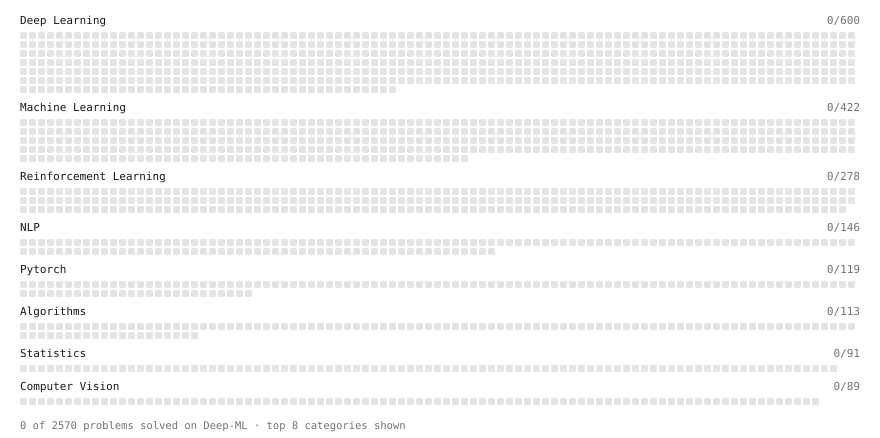

# Deep-ML

My machine learning practice from [Deep-ML](https://www.deep-ml.com). Every solution here was written by hand.

**13** solved · 0 problems · 1 labs · 12 math

[**Browse the interactive portfolio**](https://varadgunjal.github.io/deep-ml/) to replay this filling in over time.

## Labs

| | Difficulty | Solved | |
| --- | --- | --- | --- |
| [PyTorch: Implement Your Own Gradient Descent Training Step](https://www.deep-ml.com/labs/12) | medium | 2026-11-23 | [solution](labs/0012-pytorch-implement-your-own-gradient-descent-training-step) |

## Math

| | Difficulty | Solved | |
| --- | --- | --- | --- |
| [Backpropagation and the Chain Rule](https://www.deep-ml.com/math-problems/4) | medium | 2026-11-24 | [solution](math/0004-backpropagation-and-the-chain-rule) |
| [Bradley-Terry Preference Model](https://www.deep-ml.com/math-problems/51) | medium | 2026-10-20 | [solution](math/0051-bradley-terry-preference-model) |
| [Common Distributions I: Bernoulli, Binomial, Uniform](https://www.deep-ml.com/math-problems/21) | medium | 2026-11-24 | [solution](math/0021-common-distributions-i-bernoulli-binomial-uniform) |
| [Common Distributions II: Normal, Poisson, Exponential](https://www.deep-ml.com/math-problems/22) | medium | 2026-11-24 | [solution](math/0022-common-distributions-ii-normal-poisson-exponential) |
| [Law of Large Numbers and Central Limit Theorem](https://www.deep-ml.com/math-problems/23) | medium | 2026-11-24 | [solution](math/0023-law-of-large-numbers-and-central-limit-theorem) |
| [Matrix Calculus Identities](https://www.deep-ml.com/math-problems/35) | medium | 2026-11-23 | [solution](math/0035-matrix-calculus-identities) |
| [Multivariate Calculus](https://www.deep-ml.com/math-problems/2) | medium | 2026-11-24 | [solution](math/0002-multivariate-calculus) |
| [Multivariate Gaussians](https://www.deep-ml.com/math-problems/36) | medium | 2026-11-24 | [solution](math/0036-multivariate-gaussians) |
| [Regularization and Generalization](https://www.deep-ml.com/math-problems/31) | medium | 2026-11-25 | [solution](math/0031-regularization-and-generalization) |
| [Softmax and Cross-Entropy](https://www.deep-ml.com/math-problems/32) | medium | 2026-11-23 | [solution](math/0032-softmax-and-cross-entropy) |
| [Taylor Expansions and Local Quadratic Models](https://www.deep-ml.com/math-problems/37) | medium | 2026-11-24 | [solution](math/0037-taylor-expansions-and-local-quadratic-models) |
| [Matrix Decompositions: LU and QR](https://www.deep-ml.com/math-problems/15) | hard | 2026-11-25 | [solution](math/0015-matrix-decompositions-lu-and-qr) |

---

_This file is regenerated by Deep-ML on every push._
